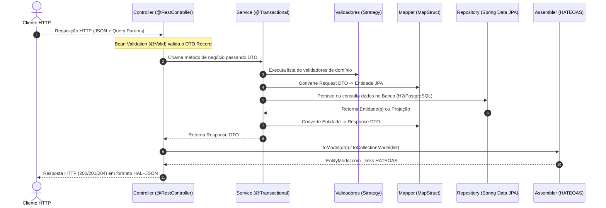

# 📖 Explicação Detalhada do Projeto — API Blog Pessoal

Este documento apresenta uma análise técnica aprofundada da **API Blog Pessoal**, detalhando sua arquitetura, fluxo de execução, modelagem de banco de dados, padrões de projeto, otimizações de performance, estratégia de testes e pontos técnicos de atenção identificados no código-fonte.

---

## 1. Propósito e Visão Geral

A **API Blog Pessoal** é um backend RESTful construído em **Java 21** com **Spring Boot 3.5.14** para gerenciar uma plataforma de publicação de artigos técnicos e interações sociais (comentários em árvore e curtidas).

O projeto foi desenhado com três preocupações centrais:
1. **Eficiência em Ambientes Restritos (VPS):** Uso de paginação por cursor (*Keyset Pagination*), retorno em `Slice` (sem `COUNT(*)`) e projeções diretas via banco de dados (`SUBSTRING`), reduzindo o consumo de memória heap da JVM e I/O do banco.
2. **Qualidade Arquitetural:** Uso de `Records` imutáveis para DTOs, mapeamento estático em tempo de compilação com **MapStruct**, navegabilidade **HATEOAS** (Richardson Nível 3) e validações extensíveis com o padrão **Strategy** (SOLID).
3. **Prontidão para Produção:** Migrações versionadas via **Flyway**, containerização **Docker Multi-stage** com usuário não-root, observabilidade integrada (**Actuator + Prometheus + Grafana**) e testes de integração contra um banco **PostgreSQL 16** real via **Testcontainers**.

---

## 2. Arquitetura em Camadas e Fluxo de Requisição

O código-fonte está organizado sob o pacote base `br.com.passos.api_blog_pessoal` utilizando a abordagem **Package-by-Layer** (divisão por responsabilidade técnica):

```text
src/main/java/br/com/passos/api_blog_pessoal/
├── config/         # Configurações de infraestrutura (JPA Auditing, CORS, OpenAPI/Swagger)
├── controller/     # Camada REST: recebe requisições HTTP, valida payloads (@Valid) e retorna HATEOAS
├── assembler/      # Empacota DTOs em EntityModel/CollectionModel adicionando links hipermídia (_links)
├── dto/            # Contratos de entrada (Request) e saída (Response) usando Java Records imutáveis
├── mapper/         # Interfaces MapStruct que geram código de conversão Entidade <-> DTO na compilação
├── service/        # Regras de negócio, controle transacional (@Transactional) e orquestração
│   └── validation/ # Validadores de negócio desacoplados baseados no padrão Strategy
├── repository/     # Interfaces Spring Data JPA, queries JPQL customizadas e JPA Specifications
├── model/          # Entidades JPA mapeadas para as tabelas relacionais do banco de dados
├── exception/      # Exceções de domínio e interceptador global (@RestControllerAdvice)
└── util/           # Utilitários puros (ex: geração e normalização de slugs)
```

### Fluxo Completo de uma Requisição


---

## 3. Modelagem de Dados e Evolução do Banco (Flyway)

O schema do banco de dados é rigorosamente controlado pelo **Flyway** (`spring.jpa.hibernate.ddl-auto: validate`), garantindo que o Hibernate apenas valide se as entidades Java correspondem exatamente às tabelas criadas pelas migrações SQL em `src/main/resources/db/migration/`:

- **`V1__create_table_usuarios.sql`**: Cria a tabela `usuarios` com restrição `UNIQUE` em `email`.
- **`V2__create_tables_posts_comentarios.sql`**: Cria `posts` e `comentarios` com chaves estrangeiras e `ON DELETE CASCADE` nos comentários quando um post é removido.
- **`V3__add_categories_tags_and_slug.sql`**: Cria as tabelas `categorias`, `tags` e a tabela associativa N:N `posts_tags`. Adiciona `slug` (único) e `categoria_id` na tabela `posts`.
- **`V4__add_likes_and_threaded_comments.sql`**:
  - Adiciona a coluna de auto-relacionamento `pai_id` em `comentarios` (`ON DELETE CASCADE`) para suportar respostas aninhadas.
  - Cria as tabelas associativas de curtidas `posts_curtidas` e `comentarios_curtidas` com chave primária composta `(post_id, usuario_id)` e `(comentario_id, usuario_id)`, impedindo curtidas duplicadas no nível do SGBD.
- **`V5__insert_dados_teste.sql`**: Insere massa inicial de dados (usuário, categorias, tags, posts e comentário) para facilitar testes imediatos após subir a aplicação.

### Auditoria Automática (`BaseEntity`)
A classe abstrata `BaseEntity` (`@MappedSuperclass`), ativada por `JpaConfig` (`@EnableJpaAuditing`), injeta automaticamente em `Usuario`, `Post` e `Comentario`:
- `dataCriacao` (`@CreatedDate`, `updatable = false`)
- `dataAtualizacao` (`@LastModifiedDate`)

---

## 4. Regras de Negócio e Padrões de Projeto

### 4.1. Separação de Alçadas (`Role.ADMIN` vs `Role.USER`)
O sistema adota uma divisão estrita de responsabilidades entre perfis administrativos e produtores de conteúdo:
- **`ADMIN`:** Gerencia a plataforma e o cadastro de usuários. Apenas um executor com papel `ADMIN` pode atualizar (`PUT /api/v1/usuarios/{id}?executorId=...`) ou excluir (`DELETE /api/v1/usuarios/{id}?executorId=...`) contas de usuários. Administradores **não podem** publicar posts nem comentar.
- **`USER`:** Cria e interage com o conteúdo. Apenas usuários com papel `USER` podem criar posts e comentar. Além disso, em operações de edição (`PUT`) e exclusão (`DELETE`) de postagens, o `PostService` valida se o `autorId` informado é o proprietário exato da publicação.

### 4.2. Strategy Pattern + Injeção Polimórfica do Spring (`service/validation`)
Para evitar métodos de serviço inchados com múltiplos blocos `if/else`, as regras de validação de criação de posts e comentários utilizam o padrão **Strategy** aliado ao princípio **Open/Closed (OCP)**:
1. A interface genérica `ValidadorRegraNegocio<T>` define o contrato `validar(Usuario autor, T request)` e um método `default` reutilizável `validarSeAutorNaoEhAdmin(...)`.
2. Interfaces específicas `ValidadorCriacaoPost` e `ValidadorCriacaoComentario` estendem a interface base.
3. Componentes como `ValidadorPostAutorNaoEhAdmin` e `ValidadorComentarioAutorNaoEhAdmin` implementam essas interfaces e são anotados com `@Component`.
4. O `PostService` declara `private final List<ValidadorCriacaoPost> validadores;`. O Spring injeta automaticamente todas as implementações registradas no contexto, e o serviço executa todas com uma única linha:
   ```java
   validadores.forEach(v -> v.validar(autor, request));
   ```
   Para adicionar uma nova regra no futuro (ex: limite diário de postagens ou filtro de palavras proibidas), basta criar uma nova classe `@Component` sem alterar uma única linha do `PostService`.

### 4.3. Normalização e Resolução de Colisões de Slugs (`SlugUtils` e `PostService`)
Toda postagem e categoria possui um `slug` amigável para SEO:
- `SlugUtils.makeSlug(String input)` aplica `Normalizer.normalize(input, Normalizer.Form.NFD)` para separar acentos das letras base (ex: `á` -> `a`), remove caracteres especiais, converte espaços em hífens (`-`) e transforma tudo em minúsculas.
- No `PostService.gerarSlugUnico(titulo)`, o sistema consulta `repository.countBySlugPrefix(slugBase, slugBase + "-%")`. Se `"java-21"` já existir, o próximo post com o mesmo título receberá automaticamente `"java-21-1"`, evitando erros de violação de constraint `UNIQUE`.

### 4.4. Criação de Tags Sob Demanda (*Find-or-Create*)
Ao criar ou atualizar um post enviando `"tags": ["Java", "Spring Boot"]`, o cliente não precisa cadastrar as tags previamente. O `TagService.buscarOuCriar(String nome)` verifica se a tag já existe no banco (`repository.findByNome(nome)`): se existir, reutiliza o registro; caso contrário, cria e persiste a nova tag dentro da mesma transação.

### 4.5. Cálculo Dinâmico de Tempo de Leitura (`PostMapper`)
O tempo estimado de leitura (`tempoLeitura`, em minutos) não é armazenado no banco de dados (evitando dados redundantes). Ele é calculado em tempo de transformação pelo `PostMapper` usando uma velocidade média de leitura de **200 palavras por minuto**:
```java
default int calcularTempoLeitura(String conteudo) {
    if (conteudo == null || conteudo.isBlank()) return 0;
    int palavras = conteudo.trim().split("\\s+").length;
    return Math.max(1, (int) Math.ceil((double) palavras / 200));
}
```

### 4.6. Comentários em Árvore (*Threaded Comments*)
A entidade `Comentario` possui um auto-relacionamento:
- `pai` (`@ManyToOne`): aponta para o comentário superior (ou `null` se for um comentário-raiz).
- `respostas` (`@OneToMany(mappedBy = "pai", cascade = CascadeType.ALL, orphanRemoval = true)`): lista de respostas diretas.
Quando o endpoint `GET /api/v1/posts/{postId}/comentarios` é chamado, o `ComentarioRepository.findRootByPostId(postId)` busca apenas os comentários onde `c.pai IS NULL`, e o `ComentarioMapper` converte recursivamente toda a hierarquia de `respostas` em uma estrutura JSON em árvore.

### 4.7. Sistema de Curtidas Idempotente (*Toggle*)
Tanto `Post` quanto `Comentario` mapeiam suas curtidas como `Set<Usuario> curtidas = new HashSet<>()`. O método `curtir(id, usuarioId)` verifica se o usuário já está presente no conjunto (`contains`):
- Se **não estiver**, adiciona o usuário (curtir / *like*).
- Se **já estiver**, remove o usuário (descurtir / *unlike*).

---

## 5. Engenharia de Performance e Consultas Avançadas

### 5.1. Otimização do Feed (`PostRepository.findFeed`)
O endpoint `GET /api/v1/posts/feed?lastId={id}&size=10` combina três técnicas de alta performance:

```java
@Query("""
        SELECT new br.com.passos.api_blog_pessoal.dto.PostFeedResponse(
            p.id,
            p.titulo,
            p.slug,
            SUBSTRING(p.conteudo, 1, 200),
            p.autor.nome,
            p.dataCriacao,
            (SELECT COUNT(c) FROM Comentario c WHERE c.post.id = p.id),
            (SELECT COUNT(l) FROM p.curtidas l)
        )
        FROM Post p
        WHERE (:lastId IS NULL OR p.id < :lastId)
        ORDER BY p.id DESC
        """)
Slice<PostFeedResponse> findFeed(Long lastId, Pageable pageable);
```

1. **Keyset Pagination (`p.id < :lastId`):** Em vez de usar paginação tradicional por `OFFSET` (onde o banco precisa varrer e descartar milhares de linhas anteriores em páginas profundas), o filtro usa o índice da chave primária (`p.id < :lastId`), mantendo tempo de resposta constante $O(1)$ e evitando itens repetidos caso novos posts sejam publicados enquanto o leitor rola a página.
2. **Retorno em `Slice` em vez de `Page`:** O `Page` do Spring Data executa obrigatoriamente uma segunda query `SELECT COUNT(*) FROM posts` para calcular o total de páginas. Em feeds de rolagem infinita (*infinite scroll*), saber o total absoluto de registros é desnecessário; o `Slice` apenas solicita `size + 1` registros para saber se há uma próxima página (`hasNext`), economizando I/O no banco.
3. **Constructor Expression + `SUBSTRING` no SGBD:** A query instancia o `PostFeedResponse` diretamente e trunca o conteúdo nos primeiros 200 caracteres dentro do próprio PostgreSQL/H2, evitando carregar textos longos (`TEXT`) na memória da aplicação.

### 5.2. Busca Dinâmica Segura com `JPA Specifications` (`PostSpecifications`)
O endpoint `GET /api/v1/posts/search` permite combinar livremente filtros opcionais (`titulo`, `conteudo`, `categoria`, `tag`).
- Cada filtro é uma `Specification<Post>` independente combinada com `Specification.where(...).and(...)`.
- Se um parâmetro não for enviado (`null` ou em branco), a specification retorna `null` e o Hibernate ignora aquele filtro na cláusula `WHERE`.
- **Proteção contra *Wildcard Injection*:** O método `escapeLike(String valor)` escapa os caracteres especiais do SQL `LIKE` (`\`, `%`, `_`) definindo `\'` como caractere de escape. Isso impede que um usuário envie `%` ou `_` na busca e force varreduras indevidas.

---

## 6. Camada REST: DTOs, HATEOAS e Tratamento Global de Erros

### 6.1. Java Records e Segurança de Dados
Todos os contratos da camada `dto/` são `record`s do Java 21 anotados com Jakarta Bean Validation (`@NotBlank`, `@Size`, `@Email`, `@NotNull`) e documentação `@Schema` do OpenAPI.
- **Proteção de dados sensíveis:** `UsuarioResponse` não possui o campo `senha`, garantindo que o hash/texto da senha jamais vaze nas respostas JSON.
- **Proteção de atualização:** `UsuarioUpdateRequest` não inclui `senha`, e o `UsuarioMapper` ignora explicitamente `id` e `senha` (`@Mapping(target = "senha", ignore = true)`).

### 6.2. Hipermídia com Spring HATEOAS (`assembler/`)
Cada recurso possui um Assembler dedicado (`PostAssembler`, `UsuarioAssembler`, `ComentarioAssembler`, etc.) que estende `RepresentationModelAssembler`. Assim, cada resposta JSON inclui o objeto `_links` indicando ao cliente quais ações estão disponíveis para aquele recurso (ex: link `self`, link para `curtir`, link para `responder` a um comentário).

### 6.3. Tratamento Centralizado de Exceções (`GlobalExceptionHandler`)
A classe `@RestControllerAdvice` captura exceções lançadas em qualquer camada e devolve o objeto padronizado `ErrorResponse` (contendo `timestamp`, `status`, `title`, `detail`, `path` e mapa opcional `details` com erros campo a campo):
- `MethodArgumentNotValidException` -> **400 Bad Request** (lista todos os campos inválidos no mapa `details`).
- `BusinessException` -> **400 Bad Request** (regras de negócio violadas ou recurso não encontrado).
- `EmailJaCadastradoException` -> **409 Conflict** (tentativa de duplicar e-mail).
- `HttpMessageNotReadableException` / `MissingServletRequestParameterException` / `MethodArgumentTypeMismatchException` -> **400 Bad Request**.
- `NoHandlerFoundException` -> **404 Not Found**.
- `Exception` -> **500 Internal Server Error** (registra o erro real no log via `@Slf4j` e retorna mensagem genérica segura ao cliente).

---

## 7. Infraestrutura, Ambientes, Docker e Observabilidade

### 7.1. Perfis de Execução (`application*.yml`)
- **`application.yaml` (Base):** Define timezone `America/Sao_Paulo`, formato de data `yyyy-MM-dd HH:mm:ss`, ativa o Flyway e expõe os endpoints do Actuator (`health`, `info`, `prometheus`).
- **`application-dev.yml` (Padrão local):** Usa banco H2 em memória (`jdbc:h2:mem:blogdb;DB_CLOSE_DELAY=-1`), habilita o console `/h2-console` e ativa logs detalhados de SQL.
- **`application-prod.yml` (Produção):** Conecta ao PostgreSQL 16 via variáveis de ambiente (`DB_URL`, `DB_USERNAME`, `DB_PASSWORD`) e desativa logs de SQL no stdout.
- **`application-test.yml` (Testes de Integração):** Configura o dialeto PostgreSQL para execução conjunta com Testcontainers.

### 7.2. Dockerfile Multi-stage Otimizado
O `Dockerfile` na raiz utiliza duas etapas:
1. **Estágio `build` (`eclipse-temurin:21-jdk-jammy`):** Copia primeiro os arquivos do Gradle para aproveitar o cache de camadas do Docker (`./gradlew dependencies --no-daemon`) e depois compila o artefato executável (`./gradlew bootJar -x test --no-daemon`).
2. **Estágio de execução (`eclipse-temurin:21-jre-jammy`):** Usa apenas a JRE (imagem menor e mais segura), cria um usuário de sistema sem privilégios de root (`spring:spring`) e inicia a JVM com parâmetros ajustados para containers:
   - `-XX:+UseContainerSupport`
   - `-XX:MaxRAMPercentage=75.0` (evita *OOMKilled* pelo Docker limitando o heap a 75% da memória do container)
   - `-Djava.security.egd=file:/dev/./urandom` (acelera a inicialização criptográfica).

### 7.3. Orquestração e Observabilidade (`docker-compose.yml`)
O `docker-compose.yml` sobe 4 containers integrados:
1. **`db` (`postgres:16-alpine`):** Com volume persistente e `healthcheck` via `pg_isready`.
2. **`api`:** Aguarda o banco ficar saudável (`condition: service_healthy`) antes de iniciar.
3. **`prometheus` (`prom/prometheus`):** Faz scraping a cada 15 segundos no endpoint `/actuator/prometheus` da API (configurado em `docker/prometheus/prometheus.yml`).
4. **`grafana` (`grafana/grafana`):** Interface visual na porta `3000` para criação de dashboards de métricas da JVM, pool HikariCP e latência HTTP.

---

## 8. Estratégia de Testes Automatizados

O projeto combina **Testes Unitários rápidos** na camada de serviço e **Testes de Integração completos** na camada de controllers:

1. **Testes Unitários (`src/test/.../service/*Test.java`):**
   - Utilizam **JUnit 5** e **Mockito** (`@ExtendWith(MockitoExtension.class)`).
   - Testam isoladamente todas as regras de negócio de `UsuarioService`, `PostService`, `ComentarioService`, `CategoriaService`, `TagService` e os validadores (`ValidadorPostAutorNaoEhAdminTest`, `ValidadorComentarioAutorNaoEhAdminTest`).
2. **Testes de Integração com Testcontainers (`src/test/.../controller/*ControllerIT.java`):**
   - Herdam de `AbstractIntegrationTest`, que sobe um container **PostgreSQL 16 real** (`PostgreSQLContainer<>("postgres:16-alpine")`) compartilhado em padrão *Singleton* com `@ServiceConnection`.
   - O Flyway roda todas as migrações `V1`..`V5` contra o banco real do container.
   - Antes de cada teste (`@BeforeEach`), um comando `TRUNCATE TABLE ... RESTART IDENTITY CASCADE` limpa todas as tabelas e reinicia as sequências de IDs, garantindo isolamento total entre os testes.
   - As requisições são disparadas de ponta a ponta via `TestRestTemplate` validando status HTTP, payloads JSON e links HATEOAS (`_links` / `_embedded`).

---

## 9. Diagnóstico Técnico: Pontos de Atenção e Melhorias Recomendadas

Durante a análise estática minuciosa do código-fonte, foram identificados **4 pontos técnicos importantes** que merecem atenção para a evolução do projeto:

### 1. Bug Lógico na Atualização de Slug ao Editar Post (`PostService.java`)
Em `src/main/java/br/com/passos/api_blog_pessoal/service/PostService.java` (linhas 102–107):
```java
post.setTitulo(request.titulo());
post.setConteudo(request.conteudo());

if (!post.getTitulo().equals(request.titulo())) {
    post.setSlug(gerarSlugUnico(request.titulo()));
}
```
- **Problema:** `post.setTitulo(request.titulo())` sobrescreve o título da entidade **antes** da comparação `if (!post.getTitulo().equals(request.titulo()))`. Consequentemente, a comparação sempre resulta em `false` e o `slug` nunca é recalculado quando o autor altera o título do post.
- **Correção sugerida:** Verificar se o título mudou **antes** de chamar `post.setTitulo(request.titulo())`.

### 2. Duplicação de Path no Link HATEOAS de Curtir Post (`PostAssembler.java`)
Em `src/main/java/br/com/passos/api_blog_pessoal/assembler/PostAssembler.java` (linhas 23–26):
```java
linkTo(PostController.class).slash("posts").slash(post.id()).slash("curtir").withRel("curtir")
```
- **Problema:** Como `PostController` já está anotado com `@RequestMapping("/api/v1/posts")`, o uso de `.slash("posts")` gera a URL `/api/v1/posts/posts/{id}/curtir` em vez de `/api/v1/posts/{id}/curtir`.
- **Correção sugerida:** Remover `.slash("posts")`, deixando `linkTo(PostController.class).slash(post.id()).slash("curtir").withRel("curtir")`.

### 3. Autenticação e Segurança (Spring Security + JWT + BCrypt)
- **Estado atual:** Atualmente a API não possui `spring-boot-starter-security`. As senhas dos usuários são salvas em texto puro no banco de dados e a identificação do autor/executor nas rotas protegidas é enviada via *Query Parameter* (`?autorId=`, `?executorId=`, `?usuarioId=`).
- **Evolução recomendada:** Adicionar **Spring Security** com `BCryptPasswordEncoder` para hash de senhas e autenticação stateless via **JWT (OAuth2 Resource Server)**, extraindo o usuário autenticado diretamente do `SecurityContextHolder` em vez de parâmetros na URL.

### 4. Prevenção de Consultas *N+1* em Listagens de Posts
- **Estado atual:** Nos métodos `PostService.listarTodos()` e `PostService.pesquisar(...)`, para cada `Post` retornado, o `PostMapper` acessa relacionamentos `LAZY` (`post.getAutor().getNome()`, `post.getCategoria()`, `post.getTags()` e `post.getCurtidas().size()`), disparando queries adicionais para cada post da lista.
- **Evolução recomendada:** Utilizar `@EntityGraph(attributePaths = {"autor", "categoria", "tags", "curtidas"})` nos métodos de busca do `PostRepository` para carregar as associações necessárias em uma única consulta SQL.
