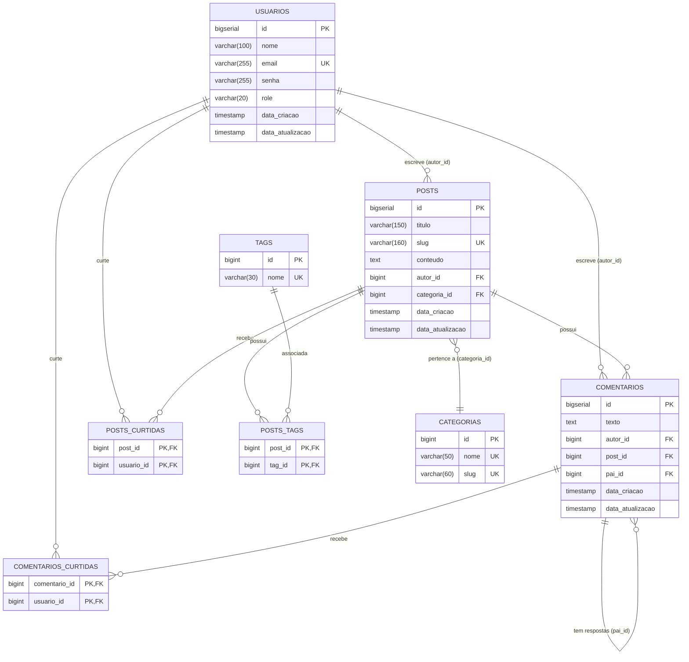

# 🚀 API Blog Pessoal — Especificação do Sistema

> **Versão:** 1.0.0 | **Status:** Em Produção / Estável  
> **Stack Principal:** Java 21 (LTS), Spring Boot 3.5.14, PostgreSQL 16, Flyway, Docker Compose

---

## 1. Visão Geral & Escopo

A **API Blog Pessoal** é uma plataforma backend RESTful de alto desempenho projetada para suportar publicação de artigos técnicos e blogs pessoais, com foco em arquitetura limpa, navegação hipermídia (HATEOAS), otimização agressiva de recursos para servidores VPS e observabilidade nativa.

### No Escopo
- Gestão e cadastro de usuários com autorização baseada em papéis (`ADMIN` e `USER`).
- Publicação de artigos/posts com cálculo dinâmico de tempo de leitura e resolução resiliente de colisões de slug.
- Feed otimizado com *Keyset Pagination* (cursor por `lastId`) e resumos gerados diretamente no banco de dados.
- Mecanismo de busca dinâmica de publicações via JPA Specifications com sanitização de caracteres coringa.
- Sistema de comentários hierárquicos (*Threaded Comments*) com suporte a respostas em múltiplos níveis.
- Sistema de curtidas com alternância (*toggle*) idempotente para posts e comentários.
- Taxonomia por Categorias (unívocas) e Tags com mecanismo de criação sob demanda (*on-demand*).
- Navegabilidade hipermídia HATEOAS (Richardson Nível 3).
- Telemetria e observabilidade prontas para Prometheus e Grafana.

### Fora do Escopo (MVP)
- Provedores externos de identidade (Keycloak, Auth0, OAuth2 social login).
- Upload direto de mídia/imagens para CDN/S3 (utiliza URLs externas para assets).
- Assinatura/monetização e gateways de pagamento.
- Multi-tenancy ou múltiplos blogs na mesma instância.
- Frontend web/mobile (a aplicação fornece exclusivamente a API REST).

---

## 2. Arquitetura & Stack Tecnológica

| Camada / Função | Tecnologia | Justificativa / Propósito |
| :--- | :--- | :--- |
| **Linguagem** | Java 21 (LTS) | Records imutáveis, Pattern Matching e Virtual Threads. |
| **Framework Base** | Spring Boot 3.5.14 | Ecossistema maduro, injeção de dependências e microsserviços REST. |
| **Persistência / ORM** | Spring Data JPA / Hibernate 6 | Abstração padronizada de queries, paginação e JPA Specifications. |
| **Banco de Dados Relacional** | PostgreSQL 16 / H2 Database | PostgreSQL em produção/testes e H2 para prototipação rápida em `dev`. |
| **Versionamento de Schema** | Flyway Core | Migrações controladas por código, idempotentes e rastreáveis. |
| **Transformação de Dados** | MapStruct 1.6.3 | Geração de mappers estáticos em compilação com zero reflexão. |
| **Hipermídia REST** | Spring HATEOAS | Respostas enriquecidas com links de navegação (Richardson Nível 3). |
| **Documentação Interativa** | SpringDoc OpenAPI 2.8.5 | Especificação viva OpenAPI 3.0 e interface Swagger UI. |
| **Métricas & Monitoramento** | Actuator + Micrometer | Exposição de telemetria em formato OpenMetrics/Prometheus. |
| **Testes Automatizados** | JUnit 5 + Mockito + Testcontainers | Testes unitários isolados e testes de integração com banco real. |

### Estrutura de Diretórios
```text
src/main/java/br/com/passos/api_blog_pessoal/
├── assembler/      # Conversores de recursos HATEOAS (RepresentationModelAssembler)
├── config/         # Configurações de CORS, Auditoria JPA e OpenAPI
├── controller/     # Camada de apresentação REST (Endpoints)
├── dto/            # Contratos imutáveis de entrada e saída (Java Records)
├── exception/      # Tratamento global de erros e contratos HTTP (@RestControllerAdvice)
├── mapper/         # Mapeadores estáticos entidade/DTO (MapStruct)
├── model/          # Entidades persistentes JPA / Hibernate
├── repository/     # Repositórios Spring Data JPA e JPA Specifications
├── service/        # Casos de uso, transações e regras de negócio
│   └── validation/ # Validadores desacoplados (Strategy Pattern)
└── util/           # Utilitários de domínio (ex: normalização de slug)
```

---

## 3. Modelo de Dados Global (ERD)



---

## 4. Matriz Geral de Endpoints

| Método | Endpoint | Módulo | Permissão / Autenticação | Descrição |
| :--- | :--- | :--- | :--- | :--- |
| `POST` | `/api/v1/usuarios` | [Usuários](modules/usuarios.md) | Livre | Cadastra novo usuário no sistema |
| `GET` | `/api/v1/usuarios/busca-por-email` | [Usuários](modules/usuarios.md) | Livre | Recupera dados do usuário pelo e-mail |
| `GET` | `/api/v1/usuarios/busca-por-nome` | [Usuários](modules/usuarios.md) | Livre | Busca usuários por termo parcial no nome |
| `PUT` | `/api/v1/usuarios/{id}` | [Usuários](modules/usuarios.md) | `ADMIN` (`executorId`) | Atualiza dados cadastrais de um usuário |
| `DELETE` | `/api/v1/usuarios/{id}` | [Usuários](modules/usuarios.md) | `ADMIN` (`executorId`) | Exclui permanentemente um usuário |
| `POST` | `/api/v1/posts` | [Posts](modules/posts.md) | `USER` (`autorId`) | Cria uma nova publicação |
| `GET` | `/api/v1/posts/feed` | [Posts](modules/posts.md) | Livre | Feed paginado por cursor (`lastId`) |
| `GET` | `/api/v1/posts` | [Posts](modules/posts.md) | Livre | Lista todas as publicações cadastradas |
| `GET` | `/api/v1/posts/{id}` | [Posts](modules/posts.md) | Livre | Recupera publicação completa por ID |
| `GET` | `/api/v1/posts/slug/{slug}` | [Posts](modules/posts.md) | Livre | Recupera publicação por slug amigável |
| `GET` | `/api/v1/posts/search` | [Posts](modules/posts.md) | Livre | Busca posts por título, conteúdo, categoria ou tag |
| `PUT` | `/api/v1/posts/{id}` | [Posts](modules/posts.md) | `USER` (autor do post) | Atualiza conteúdo da publicação |
| `DELETE` | `/api/v1/posts/{id}` | [Posts](modules/posts.md) | `USER` (autor do post) | Exclui publicação e cascata associada |
| `POST` | `/api/v1/posts/{id}/curtir` | [Posts](modules/posts.md) | Qualquer usuário (`usuarioId`) | Alterna curtida no post (toggle) |
| `POST` | `/api/v1/posts/{postId}/comentarios` | [Comentários](modules/comentarios.md) | `USER` (`autorId`) | Adiciona comentário-raiz ao post |
| `GET` | `/api/v1/posts/{postId}/comentarios` | [Comentários](modules/comentarios.md) | Livre | Lista árvore hierárquica de comentários |
| `POST` | `/api/v1/comentarios/{id}/respostas` | [Comentários](modules/comentarios.md) | `USER` (`autorId`) | Envia resposta aninhada a comentário |
| `POST` | `/api/v1/comentarios/{id}/curtir` | [Comentários](modules/comentarios.md) | Qualquer usuário (`usuarioId`) | Alterna curtida no comentário (toggle) |
| `POST` | `/api/v1/categorias` | [Categorias & Tags](modules/categorias-tags.md) | Livre | Cadastra uma nova categoria |
| `GET` | `/api/v1/categorias` | [Categorias & Tags](modules/categorias-tags.md) | Livre | Lista todas as categorias |
| `GET` | `/api/v1/tags` | [Categorias & Tags](modules/categorias-tags.md) | Livre | Lista todas as tags cadastradas |
| `GET` | `/actuator/health` | [Infra & Ops](modules/infra-ops.md) | Livre | Diagnóstico de integridade do sistema |
| `GET` | `/actuator/info` | [Infra & Ops](modules/infra-ops.md) | Livre | Informações de build e runtime |
| `GET` | `/actuator/prometheus` | [Infra & Ops](modules/infra-ops.md) | Livre | Coleta de telemetria para Prometheus |

---

## 5. Padrão Global de Erro HTTP

Erros de validação, conflitos de negócio e falhas internas são interceptados pelo [`GlobalExceptionHandler`](file:///c:/Users/paulo/Documents/GitHub/api-blog-pessoal/src/main/java/br/com/passos/api_blog_pessoal/exception/GlobalExceptionHandler.java) e retornados no formato padronizado:

```json
{
  "timestamp": "2026-09-13 15:30:00",
  "status": 400,
  "error": "Erro de validação de campos",
  "message": "Um ou mais campos estão inválidos",
  "path": "/api/v1/usuarios",
  "details": {
    "email": "Email inválido",
    "senha": "A senha deve ter no mínimo 8 caracteres"
  }
}
```

### Mapeamento de Códigos HTTP

| Status HTTP | Erro | Cenário Disparador |
| :--- | :--- | :--- |
| `400 Bad Request` | `MethodArgumentNotValidException` | Falha de Bean Validation (`@Valid`) nos payloads. Retorna campos em `details`. |
| `400 Bad Request` | `BusinessException` | Violações de regras de negócio (ex: usuário não encontrado, perfil sem permissão). |
| `400 Bad Request` | `HttpMessageNotReadableException` | Corpo JSON malformatado ou ausente. |
| `400 Bad Request` | `MissingServletRequestParameterException` | Query parameter obrigatório ausente. |
| `400 Bad Request` | `MethodArgumentTypeMismatchException` | Conversão inválida de tipo nos parâmetros de rota/query. |
| `404 Not Found` | `NoHandlerFoundException` | Rota inexistente na API. |
| `409 Conflict` | `EmailJaCadastradoException` | Tentativa de cadastro ou atualização com e-mail já existente. |
| `500 Internal Error` | `Exception` (Genérica) | Erros imprevistos. Registra log via `@Slf4j` e oculta stack trace sensível. |
